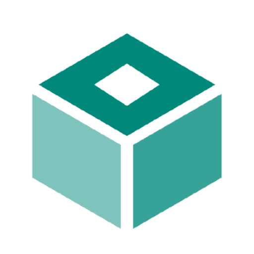
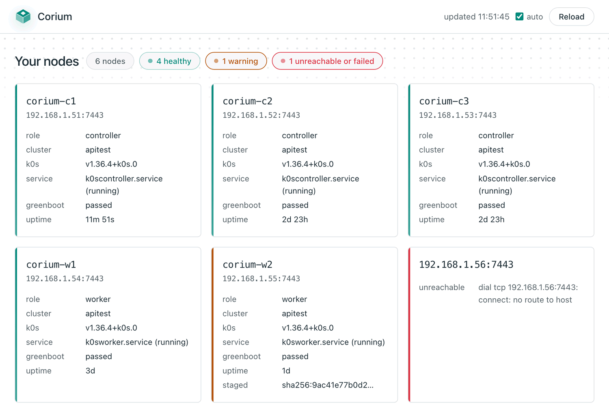

<p align="center">
  
</p>

<h1 align="center">Corium</h1>

<p align="center">
  An immutable, container-native Linux distribution that boots into a Kubernetes node.
</p>

<p align="center">
  <a href="https://github.com/Corium-OS/Corium/releases/latest"></a>
  <a href="https://github.com/Corium-OS/Corium/actions/workflows/ci.yml"></a>
  <a href="https://github.com/Corium-OS/Corium/actions/workflows/image.yml"></a>
  
  
  
  <a href="go.mod"></a>
  <a href="LICENSE"></a>
</p>

Corium is [Fedora bootc](https://docs.fedoraproject.org/en-US/bootc/) with
[k0s](https://k0sproject.io/) in the read-only system. You can choose the Kubernetes version
independently of the OS image. A small declarative configuration layer sits on top of
cloud-init.

> **Status: 0.x.** The architecture is settled and the path works end to end. A node boots,
> joins, upgrades, drains itself before it reboots, rolls back when it comes up broken, and
> refuses an image that is not signed. Two things are not settled. First, the configuration
> surface can still change between minor releases. Second, the testing is narrower than it
> looks. All tests ran on virtual machines, and none ran on physical hardware. Pin a
> version, read the [changelog](CHANGELOG.md), and do not put anything on it that you would miss.

---

## What it looks like

A complete single-node Kubernetes cluster:

```yaml
#cloud-config
corium:
  role: single
```

A worker joining an existing one:

```yaml
#cloud-config
corium:
  role: worker
  join:
    token: <k0s join token>
```

That is the whole interface for the common case. Everything else has a default, and you
can override every default. See [examples](docs/examples.md) for the full surface,
including the escape hatches (the raw cloud-init and k0s settings).

---

## Managing a node

Every node runs a small management API. The API answers only for its own node. It is on
by default. If you install a machine from the ISO with no configuration, the machine prints
a pairing code on its console. Then it waits for you to tell it what it is, so it is never
unreachable. [`cctl`](docs/cli.md) is the client. It claims a node, reads what the node is,
restarts a service, drains the node, and moves it to a new image. `cctl ui` is the same
client with a web page in front of it.

<p align="center">
  <picture>
    <source media="(prefers-color-scheme: dark)" srcset="docs/assets/dashboard-dark.png">
    
  </picture>
</p>

**It runs on your machine, not on the nodes.** The server listens only on loopback and
holds your client certificate. It talks to each node over the same mutual TLS that every
other command uses. When somebody opens a browser, no machine gains a port, a password, or
a session. This keeps [what it is not](#what-it-is-not) true. The page reads, restarts a
unit, cordons, uncordons, and drains. It cannot reboot, reset, apply a configuration, or
upgrade anything. Those actions are irreversible, or they are rollouts where the order
across nodes matters. A button is the wrong tool for both.

---

## The idea

Corium has three properties. The project chose them together because each one supports
the others.

**The operating system is a container image.** The project builds Corium with a
`Containerfile`, pushes it to a registry, and versions it by digest. You inspect it with
`podman` and scan it with the scanner that you already run. You promote it between
environments by moving a tag, and you roll it back atomically. You do not have to learn a
separate toolchain to build images, because the one you use for your applications already
works.

**Kubernetes ships with the OS, and its version is still yours to choose.** The k0s binary
is in the read-only `/usr`. Thus a node always has a working Kubernetes and needs no network
to get one. A signed system extension can replace that binary with a different version. This
makes the Kubernetes version a separate axis. A Fedora security fix does not force a
Kubernetes minor upgrade, and a move between Kubernetes releases does not require an OS
rebase. Both axes stay immutable, because nothing is ever written in place. A node stays a
disposable artefact that you rebuild from a digest. It is not a machine that collects state.

**Configuration is cloud-init, where cloud-init exists.** Corium does not use a custom API
or a new configuration language. It uses cloud-init, which every hypervisor and cloud
already supports. Corium adds a `corium:` block that replaces the tedious parts with a few
keys. When you need something that the block does not cover, the block does not get in your
way.

Some machines have no cloud-init, for example bare metal without a seed device, PXE, or an
appliance shipped preconfigured. On those machines, Corium reads the same configuration from
a file, the kernel command line, or a default baked into the image. One schema has four
sources.

## What it is not

Corium is not a fleet manager. It provisions nodes and stops there. It does not fork or
patch k0s. It does not invent a configuration language. The project leaves these out on
purpose. It is an opinionated integration, and its value is in what it does not do.

## Prior art, honestly

[Talos Linux](https://www.talos.dev/) is the dominant option in this area, and it is
excellent. It is also an API-driven system with no shell and with its own configuration
model. To choose it is a real commitment. [Kairos](https://kairos.io/) covers similar
ground: an immutable OS, a pluggable Kubernetes distribution, and cloud-init configuration.
But Kairos builds its own A/B partition scheme on top of any base distribution, on purpose.
It does not use the OSTree/bootc lineage.

Corium makes a narrower and more specific bet. Some teams already work in OCI registries and
GitOps. For these teams, an operating system that *is* an image is worth more than a custom
mechanism, even a good one. They build, sign, scan, and promote it like every other image
they ship.

The [comparison](docs/comparison.md) covers these and the other options in full. It also
names the cases where a different option is a better fit.

## Where a node's configuration comes from

Corium tries the sources in order, the most specific first. The first source that
answers wins:

| Source | For |
|---|---|
| `/etc/corium/config.yaml` | An operator's answer for this machine |
| cloud-init | Every cloud and hypervisor: NoCloud, ConfigDrive, EC2, Azure, GCE, OpenStack, Hetzner, VMware |
| `corium.config=` on the kernel command line | PXE and netboot, where the command line is all you control |
| `/usr/share/corium/config.yaml` | A default baked into a derived image |

If a source fails for any reason other than being absent, the search stops. If a
configuration URL is unreachable, Corium does not know your intent. A fallback to a baked-in
default in that case is how a node joins the wrong cluster without a warning.

## Installable artefacts

`mise run artefacts` uses
[image-builder](https://github.com/osbuild/image-builder) to produce these artefacts:

| Artefact | For | Built by |
|---|---|---|
| `qcow2` | Proxmox, KVM, libvirt | `image-builder build --bootc-ref` |
| `raw` | Bare metal, and most clouds' import paths | `image-builder build --bootc-ref` |
| `anaconda-iso` | Interactive or kickstarted bare-metal installs | the `bootc-image-builder` entry point |

The project pins both builders by digest, and both come from the same upstream release.
The disk images use the code path that upstream develops. The ISO uses the compatibility
entry point that `bootc-image-builder` left behind when upstream archived it in June 2026.
That entry point is the only one that still builds the ISO type, and upstream is also
removing that type. [ADR 9](docs/adr/0009-image-builder.md) is the plan for the rest.

You must build these only if you changed the image. Every release publishes a ready-made,
signed ISO and qcow2. [**Downloads**](docs/install/downloads.md) tells you where they are,
why nothing is attached to the release itself, and how to verify what you downloaded.

## Documentation

**Start here**

- [**Concepts**](docs/concepts.md) : how it works and why it has this design
- [**Quick start**](docs/quickstart.md) : from a published image to a working node in four steps
- [**Which install guide**](docs/install/choosing.md) : pick the path that matches your target
- [**Troubleshooting**](docs/troubleshooting.md) : failures, indexed by what you see

**Installing**

- [**Downloads**](docs/install/downloads.md) : where the ISO and the qcow2 are published, and how to verify them
- [**Proxmox**](docs/install/proxmox.md) : a node on a Proxmox host, from start to finish
- [**OpenStack**](docs/install/openstack.md) : a node on an OpenStack cloud, with the UEFI image
- [**Rescue mode**](docs/install/rescue.md) : a dedicated server, installed from the rescue system of a provider
- [**HA cluster**](docs/install/ha-cluster.md) : how to build a three-controller control plane by hand
- [**Stretched cluster**](docs/install/stretched-cluster-wireguard.md) : one cluster across two locations

**Operating**

- [**Upgrades**](docs/upgrades.md) : how to move a node to a new image, change its Kubernetes version, and roll back
- [**cctl**](docs/cli.md) : every command of the management CLI, what each role can do, and how to read a refusal
- [**Building your own image**](docs/derived-images.md) : how to derive an image and sign it so that nodes accept it
- [**Cilium**](docs/cilium.md) : how to replace kube-router, including the variant without kube-proxy
- [**Software RAID**](docs/raid.md) : mdadm arrays on the spare disks of a node, and the status of a RAID root
- [**WireGuard overlay**](docs/wireguard-overlay.md) : how to join hosts across sites over an encrypted overlay

**Reference**

- [**Configuration reference**](docs/reference.md) : every field, and what Corium does with it
- [**Examples**](docs/examples.md) : annotated documents for each common node shape
- [**Feature support**](docs/features.md) : what is modelled, what passes through to k0s, and what is out of scope
- [**Comparison**](docs/comparison.md) : Talos, Kairos, Flatcar, and when not to use Corium
- [**Changelog**](CHANGELOG.md) : what each release changed, and the known faults
- [`AGENTS.md`](AGENTS.md) : guidelines for contributors and agents, and architectural decisions
- [`docs/adr/`](docs/adr/) : architecture decision records

## Licence

MIT. See [`LICENSE`](LICENSE).
